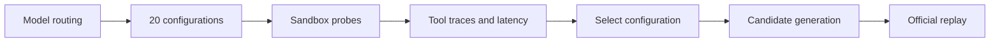

# OpenAI AI Agent Security · Silver Medal

**58 / 4,186 teams · Top 1.39% · Kaggle Silver Medal**

Team solution for **AI Agent Security — Multi-Step Tool Attacks**, hosted by **OpenAI, Google, and IEEE**. This repository organizes the supplied final competition submission into readable source modules and a reproducible single-file build.

[Official competition](https://www.kaggle.com/competitions/ai-agent-security-multi-step-tool-attacks/overview) · [Method](docs/method.md) · [Reproduction](docs/reproduction.md) · [Mayin's profile](https://github.com/mayin0902)

## Result

| Item | Value |
| --- | --- |
| Medal | **Silver** |
| Team rank | **58 / 4,186 (Top 1.39%)** |
| Participation | **Jun–Sep 2026** |
| Target models | GPT-OSS and Gemma |
| Search pool | 20 configurations per model |
| Probe budget | 30 probes per configuration; final 20 used for ranking |
| Output | Up to 2,000 candidates per model |

The rank and medal are participant-confirmed team results. The local checks in this repository validate packaging and candidate structure; they do not reproduce a leaderboard score.

## Approach

The final solution searches model-specific candidate configurations, observes tool execution traces, and selects a configuration using an estimated reward-per-second heuristic. It then generates candidates with deterministic parameter variation for independent replay by the official evaluator.



- **Behavior-based feedback:** inspect successful tool actions rather than relying on the model's textual acknowledgement.
- **Model-specific search:** separate GPT-OSS and Gemma configuration pools.
- **Time-aware selection:** rank configurations using heuristic tool-action reward divided by probe time.
- **Replayable output:** enforce a single user message per candidate and exclude the fixed test marker used in an earlier approach.

Despite the competition's title, this final solution primarily uses **k1, single-message candidates targeting one tool action**. Embedded role-format fragments do not constitute real multi-turn conversations. Candidate counts are not counts of verified vulnerabilities.

## Repository layout

```text
configs/competition.json        Original notebook's search settings
submission/attack_template.py   Search, routing, trace feedback, candidate interface
src/attacks/                    Five extracted original source modules
scripts/build_submission.py     Build dist/attack.py without running models
scripts/run_kaggle.py           Apply competition settings and start official server
tests/                         Packaging and offline structural checks
reference/original_submission.py  Unmodified supplied CD.py artifact
reference/provenance.json       Source and module SHA-256 checksums
docs/                          Method and reproduction notes
```

The historical module names are retained for traceability. The larger template bank contains unused experimental variants; only the two 20-configuration lists in the entry point define the final search pools. Start with `submission/attack_template.py`, not the template bank.

## Local quick start

Use **Python 3.11+**. Building and checking the repository requires only the Python standard library.

```bash
python scripts/build_submission.py
python -m unittest discover -s tests -v
```

The build writes `dist/attack.py`. It embeds the readable modules into one file and preserves the supplied algorithm. Tests verify source equivalence, routing, all 40 active configurations, candidate shape, marker exclusion, and selected trace-feedback behavior using a minimal SDK test double. They make no model calls.

## Official evaluation

The real runtime requires the competition-provided **`aicomp_sdk` and `kaggle_evaluation`**, the target models, and the official notebook environment. These dependencies and model weights are not included or replaced by the test double.

After attaching the official competition resources in Kaggle, run from the repository directory:

```bash
python scripts/run_kaggle.py
```

This applies `configs/competition.json`, builds `/kaggle/working/attack.py`, performs candidate-structure checks using the installed SDK, writes the required placeholder CSV, and starts the original evaluation server. The placeholder zeros are **not competition results**. See [reproduction notes](docs/reproduction.md) for the distinction between notebook settings and bare-module defaults.

## Scope and provenance

The prompts are benchmark test inputs for the official offline sandbox. Tool names, addresses, and fixed markers inside the historical source are simulated benchmark arguments. Use the entry point only with the intended competition environment.

This is an organized release of a **team competition solution**, maintained by Mayin. The original artifact is preserved byte-for-byte; the readable modules are extracted without executing it. The release adds documentation, build tooling, and offline checks. It does not claim that the tests establish SDK compatibility, replay success, or general security failures in real services.
